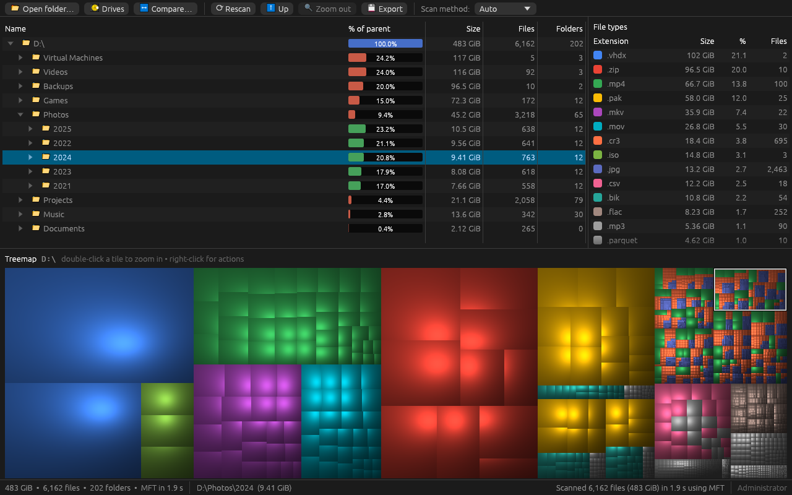
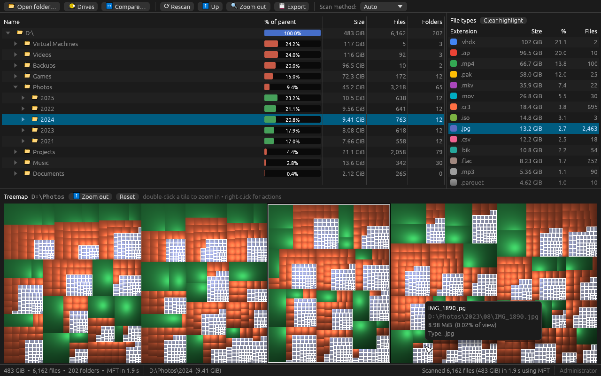
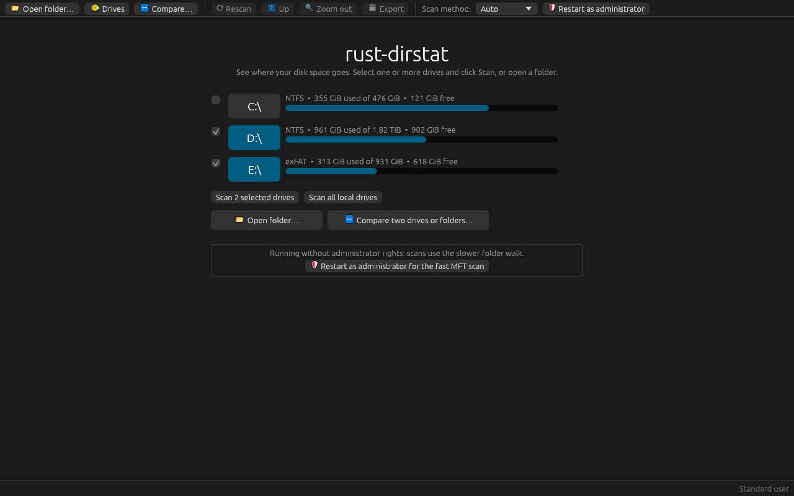
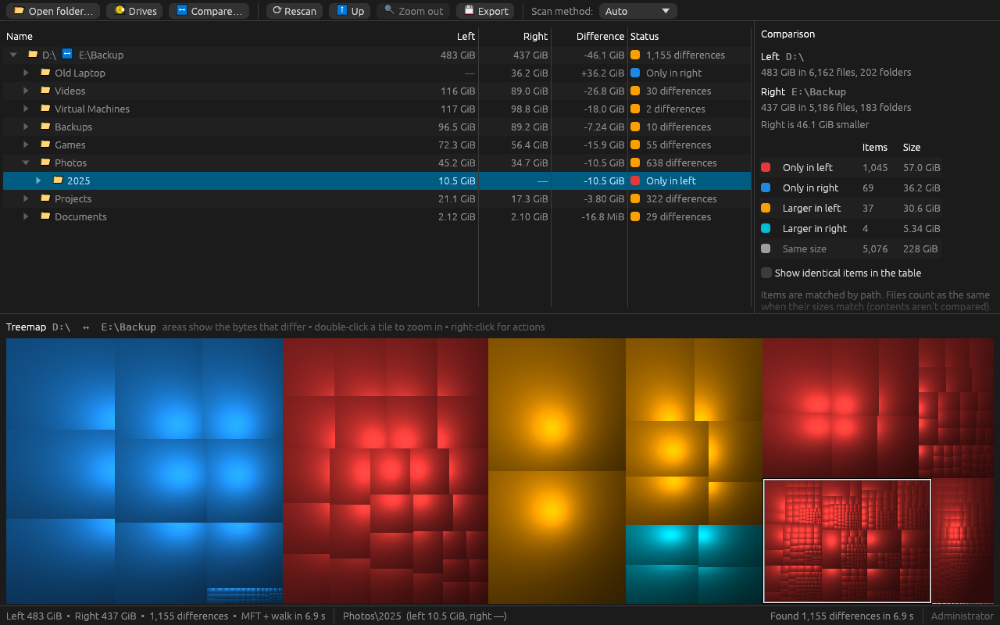

# rust-dirstat

A WinDirStat-style disk usage analyzer for Windows, written in Rust. It scans drives or folders and shows where the space goes in three views:
- a directory tree;
- a breakdown by file type;
- a cushion-shaded treemap, where every file is a tile sized by its bytes and colored by its type.



## Features

- **Fast NTFS scans.** Run as administrator, rust-dirstat reads the drive's Master File Table directly instead of walking folders, so even millions of files take seconds. Without admin rights it uses a parallel folder walk, and the status bar says why.
- **Several drives at once.** Select drives and scan them together into one combined view.
- **Compare two drives or folders**, such as a disk and its backup. You see what is only on one side and what differs in size.
- **Linked views.** Clicking a tile selects it in the tree, and the reverse. Double-click a tile to zoom into it. Click a file type to highlight its tiles.
- **File actions** (right-click): Open, Reveal in Explorer, Copy path, Rescan folder, Move to Recycle Bin.
- **Export** to CSV or JSON, from the window or the command line.
- **Command-line mode** for scripts: a text report of the largest folders, files and file types.

| Zoomed into a folder, with `.jpg` files highlighted | Welcome screen with two drives selected |
|---|---|
|  |  |

*The screenshots show made-up example data.*

## Comparing two drives or folders

Click **↔ Compare…** and choose a left and a right location: a drive, a folder, or one of each. rust-dirstat scans both at the same time, then matches them item by item.



- **Matching:** items are matched by path, ignoring case as Windows does.
- **What counts as different:**
  - Files are compared **by size**, so two files of the same size count as the same. Their contents aren't read.
  - A file and a folder with the same name count as two different items.
- **The table** lists only the items that differ, biggest difference first (for a folder, the bytes that differ inside it). Columns:
  - **Left** and **Right:** the sizes on each side;
  - **Difference:** right minus left;
  - **Status:** what changed.

  Tick **Show identical items in the table** to list everything.
- **The treemap** shows only the differences: a tile's area is the bytes that differ.

  | Color | Meaning |
  |---|---|
  | Red | Only in left |
  | Amber | Larger in left |
  | Blue | Only in right |
  | Cyan | Larger in right |

  Click a kind of difference in the side panel to highlight its tiles.
- **Right-click** an item to reveal it, or copy its path, on either side.
- **Rescan** compares the same two locations again.
- **Export** writes one CSV row per difference.

## Download

From the [Releases](https://github.com/joreeves/rust-dirstat/releases) page, download either of these:
- **Installer (recommended):** `rust-dirstat-vX.Y.Z-windows-x64-setup.exe`.
  - Installs for your user account only, with no admin prompt. Admins can choose to install for all users.
  - Adds a Start menu entry and can add `rust-dirstat` to your PATH for terminal use.
  - Installing a newer version upgrades in place.
  - Uninstall from **Settings > Apps**.
  - Silent install: `setup.exe /VERYSILENT /TASKS="addtopath"`.
- **Portable zip:** `rust-dirstat-vX.Y.Z-windows-x64.zip`. Unzip it and run `rust-dirstat.exe`.

`SHA256SUMS.txt` has checksums for both. The files aren't code-signed, so Windows SmartScreen may warn the first time you run them.

### Updates

When the window opens, rust-dirstat checks for a newer release in the background. If it finds one, the status bar says so:
- **Installed with setup.exe:** click **⬆ Update to vX.Y.Z**. The app downloads the new installer and closes. The installer then upgrades in place, keeping your options (such as the PATH entry), and opens the app again. **What's new** opens the release notes.
- **Portable copy (from the zip):** **⬆ Update available: vX.Y.Z** opens the release page, where you download the new version.

Also:
- **What the check sends:** one request to `api.github.com`, carrying only the app's name and version. Nothing is downloaded until you click **Update**.
- **When offline:** the check fails silently.
- **From a terminal:** `rust-dirstat check-update` checks; `rust-dirstat update` downloads and runs the installer.
- **To turn the check off:** set the environment variable `DIRSTAT_NO_UPDATE_CHECK=1`.

## Usage

Run `rust-dirstat.exe` to open the window.
- **Scan:** select one or more drives (or use **Open folder…**), then click **Scan selected drives**. **Scan all local drives** scans every drive in one go.
- **Combined view:** several drives appear side by side under one root (`C:\ + D:\`). A drive that can't be scanned is skipped, and the status bar says why.
- **Rescan** scans the same drives or folder again.
- **Fast scan:** click **Restart as administrator** to use the MFT scan.

From a terminal:

```powershell
rust-dirstat gui D:\Projects             # open the window and scan right away
rust-dirstat gui C:\ D:\                 # several drives/folders in one view
rust-dirstat gui --compare D:\ E:\Backup # open the window comparing two locations

rust-dirstat scan D:\Projects            # text report
rust-dirstat scan C:\ D:\ --top 10       # one report covering both drives
rust-dirstat scan C:\ --depth 2 --files 20 --extensions 10 --stats
rust-dirstat scan D:\ --csv d.csv --json d.json --json-depth 3

rust-dirstat diff D:\ E:\Backup          # compare two drives/folders (alias: compare)
rust-dirstat diff D:\Photos E:\Photos --depth 2 --files 20 --csv differences.csv
rust-dirstat check-update                # is there a newer release?
rust-dirstat update                      # install it (copies installed with setup.exe)
rust-dirstat --version
```

`--method auto|mft|walk`:
- `auto` (the default) uses the MFT when it can and otherwise falls back to the walk, saying why (for example `MFT unavailable: not elevated`).
- `mft` fails instead of falling back.
- `walk` always walks folders.

Keys in the tree:
- **↑/↓** move the selection.
- **→/←** expand or collapse a folder. **←** on a file selects its parent.
- **Home/End** jump to the first or last row.
- **Enter** opens a file or expands a folder.
- **Delete** asks before moving the item to the Recycle Bin.

## How sizes are counted

- **Logical size.** Sizes are each file's logical size (what Explorer calls *Size*, not *Size on disk*), the same as WinDirStat's size column.
- **Hard links** count once per link, so the MFT and walk scans give the same totals.
- **Symlinks, junctions and mount points** are listed as zero-size entries and never followed.
- **MFT whole-drive scans:**
  - NTFS metadata files (`$MFT`, `$LogFile`, `$Extend\…`) appear under `<NTFS metadata>`.
  - Files whose parent folder is missing or stale appear under `<Orphaned>`.
  - The MFT is read as it is on disk, so changes from the last few seconds may not show up yet.

## Building from source

```powershell
cargo build --release
# binary: target\release\rust-dirstat.exe
```

Requires Rust 1.88+ (edition 2024). rust-dirstat is developed on Windows. The walker, treemap, CLI and GUI also build on other platforms, but the MFT scanner and Explorer integration are Windows-only.

## Tests

```powershell
cargo test                        # unit, integration and headless GUI tests (egui_kittest)
cargo clippy --all-targets -- -D warnings
```

**MFT parser tests** need no admin rights:
- They feed the parser hand-built FILE records, plus a small in-memory NTFS volume image.
- The image checks that reads are aligned. It covers a fragmented `$MFT`, an `$ATTRIBUTE_LIST`, extension records, junctions, and records past the initialized size.
- The parser is also fuzzed.

**Real-data comparisons.** Two further tests compare the MFT scanner with the walker on real files, so they need an **elevated** terminal:

```powershell
cargo test --release --test mft_admin -- --ignored --nocapture
```

- **Fixture comparison:** builds a set of test files (hard links, alternate streams, a compressed file, a junction, Unicode names, deep nesting), then requires both scans to match exactly.
- **System32 comparison:** scans `C:\Windows\System32` both ways and allows at most 0.1% of entries to differ.

**Screenshots.** The README screenshots are rendered by a headless test from made-up data. To regenerate them after a UI change:

```powershell
cargo test --lib readme_screenshots -- --ignored   # writes docs/screenshots/*.png
```

## Versions and releases

- **Version numbers** follow [Semantic Versioning](https://semver.org/). The version in `Cargo.toml` is the single source: `rust-dirstat --version` and the window title both show it.
- **Changelog:** each pull request adds its user-visible changes under **Unreleased** in [CHANGELOG.md](CHANGELOG.md). A release turns those notes into its own section.
- **Builds:** the [Build and release](.github/workflows/release.yml) workflow runs on every pull request and every push to `main`:
  - runs clippy, the tests and a release build;
  - builds the zip and the installer (from [installer/rust-dirstat.iss](installer/rust-dirstat.iss), using a pinned Inno Setup 6);
  - on the runner, installs the latest published release, upgrades it to this build, reinstalls and uninstalls, checking each step;
  - attaches everything to the run as an artifact.

**Releases are automatic.** Merging a pull request that changes the app publishes a new release; there's nothing to run by hand. The run on `main`:

1. picks the version (see [scripts/release-plan.ps1](scripts/release-plan.ps1)):
   - the next **minor** version (0.2.0 → 0.3.0) when the Unreleased notes have an **Added** section;
   - otherwise the next **patch** version (0.3.0 → 0.3.1);
   - or the version in `Cargo.toml`, if a pull request set it higher by hand (for example 1.0.0);
2. builds and checks that version as above;
3. commits it to `main` as **Release vX.Y.Z** (`Cargo.toml`, `Cargo.lock`, and the notes moved under a dated heading in the changelog), and tags that commit;
4. publishes the GitHub release with the installer, the zip, `SHA256SUMS.txt` and the changelog notes.

Merges that only touch docs, the workflow or scripts are built but not released. A pull request's run summary says what merging it would release. Installed copies see new releases through the update check.

To build the installer locally, install [Inno Setup 6](https://jrsoftware.org/isinfo.php) and run `ISCC.exe /DAppVersion=X.Y.Z installer\rust-dirstat.iss` after `cargo build --release`. The setup file is written to `dist\`.

## Code map

| Path | What it does |
|---|---|
| `src/model.rs` | Arena tree (`Tree`, `NodeId`): bottom-up totals, largest-first order, per-extension stats, remove/graft for deletes and rescans, combining several drives |
| `src/scan/walk.rs` | Parallel `std::fs` walker (rayon) |
| `src/scan/mft/` | Raw MFT reader. `boot`, `fixup`, `runs`, `record` and `chunk` are pure parsers that never panic on bad data. `io` does the aligned volume reads and finds the `$MFT`, even when it's fragmented through `$ATTRIBUTE_LIST`. `index` joins the records into the tree. |
| `src/treemap/` | Squarified layout and van Wijk cushion shading into an RGBA buffer |
| `src/gui/` | eframe app; the treemap is rendered on a background thread and uploaded as a texture |
| `src/diff.rs` | Comparing two scans: matches the trees by path into one tree sized by the bytes that differ, with per-item left/right sizes and status |
| `src/export.rs`, `src/cli.rs` | CSV/JSON writers and the text reports |
| `src/update.rs` | Update check against the latest GitHub release; downloads and starts its installer |
| `installer/rust-dirstat.iss` | Inno Setup script for the installer |
| `assets/` | App icon: `icon.svg` (with `icon-small.svg` for 16–24 px) is the source; `rust-dirstat.ico` and `icon-256.png` are generated from it by `cargo run --example make_icon` |
| `build.rs` | Embeds the icon and version details in `rust-dirstat.exe` |

## License

[MIT](LICENSE)
